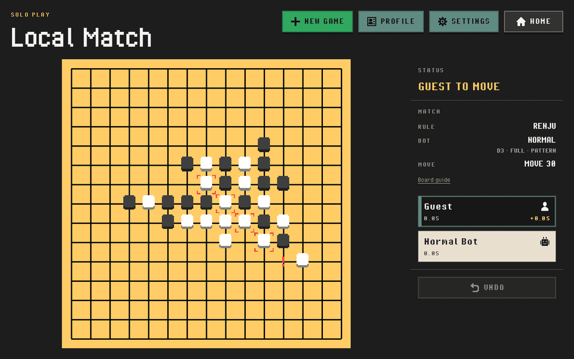
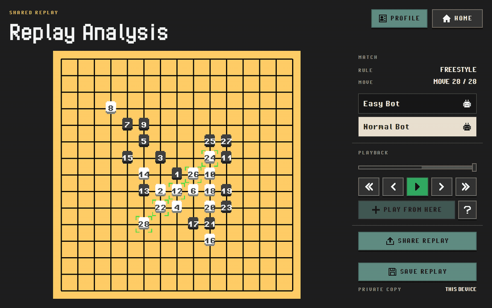
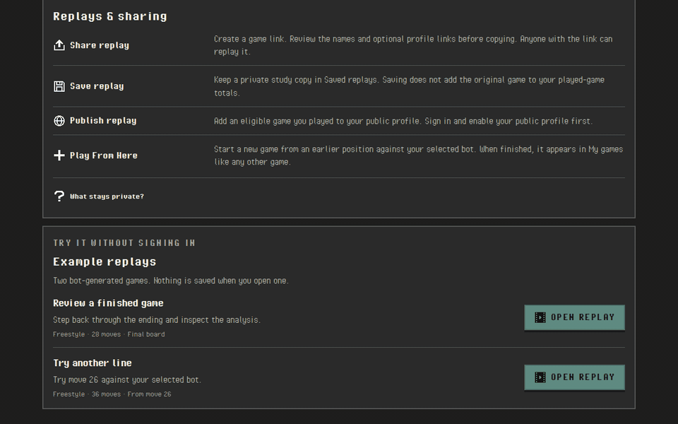
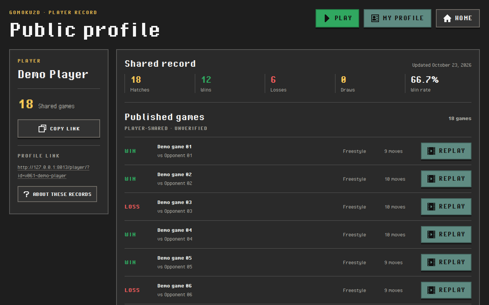
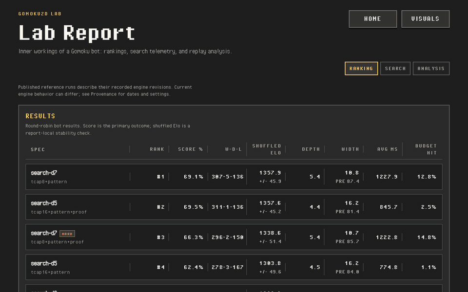
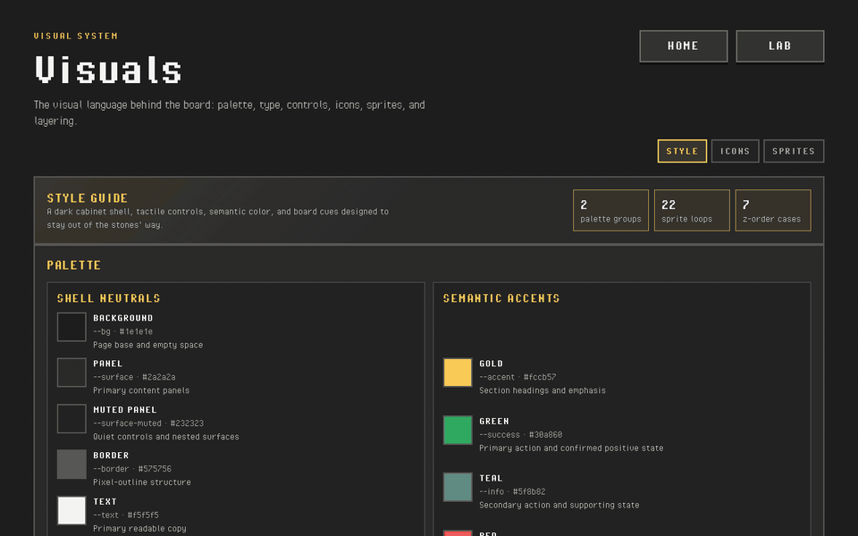

# Gomoku2D

*An old favorite, built properly.*

Play Gomoku and Renju in your browser, review how a game turned, and try
another line. Gomoku2D combines configurable bots, tactical hints, replay
analysis, and practice from earlier positions.

**[Play in your browser](https://gomoku2d.byebyebryan.com/)** — no account required.

[Rules](https://gomoku2d.byebyebryan.com/rules/) ·
[Guide](https://gomoku2d.byebyebryan.com/guide/) ·
[Lab](https://gomoku2d.byebyebryan.com/lab/) ·
[Visuals](https://gomoku2d.byebyebryan.com/visuals/) ·
[Docs](docs/README.md)

Developer-area source and review/export workflow: [maintainer contract](docs/reference/app/developer_area.md).
Its 0.6.3 implementation is local until the next authorized release; the public
site remains on the release identified below.

[](https://github.com/byebyebryan/gomoku2d/actions/workflows/ci.yml)



Capture versions and sources are recorded in [media provenance](docs/assets/README.md).
See [Project status](#project-status) for publication status.

## Play

- Start immediately against Easy, Normal, or Hard bots; no account is required.
- Choose Freestyle or Renju, including recursive Renju forbidden-move checks.
- Tune bot depth, width, scoring, and proof options through advanced settings.
- Enable hints for immediate threats, imminent threats, counter threats, and
  the stones behind them.
- Play on desktop or portrait mobile with dedicated touch controls.
- Keep history locally, or sign in with Google for private cloud continuity.

Bot decisions use the same tactical model as hints, replays, and the lab, so
you can examine the threats behind a move.

## Analyze

Replay Analysis walks backward from the ending through the losing side's
decisions. It looks for forcing sequences and possible alternatives within a
bounded tactical model:

- **Combo onset:** the lethal threat that settled the result.
- **Setup corridor:** the forced sequence that led into that threat.
- **Last escape:** the latest position where the model finds a confirmed or
  possible escape.
- **Failure step:** the missed response, prevention, or escape when the analyzer
  can classify one.

The replay can still be scrubbed normally, and any eligible frame can become a
new practice game.

Analysis is bounded: a confirmed escape clears the modeled forcing corridor;
a possible escape still needs verification. It is not a full-game solution.



## Keep And Share

- Send a complete replay as a link, opening at a chosen move.
- Keep private study copies in Saved replays; completed continuations remain
  ordinary My games.
- Publish selected own games and an optional dated statistics snapshot on a
  public player profile.

[Example replays](https://gomoku2d.byebyebryan.com/guide/#examples) and short
sharing help are available in Guide. Examples need no account.





## Inspect The System

The Rust lab powers the browser bot, Replay Analysis, and the tactical
vocabulary shared by the game. The published report lets you inspect bot
rankings, search telemetry, and analyzed games.

The curated report data retains its historical measurement dates and source
provenance.



The Visuals guide publishes the other half of the system: pixel sprites, icons,
source sheets, design tokens, and the layering rules used on the board.



## How It Was Built

Gomoku2D began as an unfinished project from nearly a decade ago and returned
as a one-developer, agent-assisted production experiment. Agents made its
breadth practical across implementation, analysis, review, docs, reports, and
release work. The human still owns the decisions that define the project:
taste, scope, domain reasoning, and technical judgment.

## Inside The Repository

```text
gomoku2d/
├── gomoku-web/         browser app: React shell, Phaser board, wasm bridge
├── gomoku-bot-lab/     Rust lab: rules, bots, analyzer, eval, CLI, wasm
├── reports/lab/        curated JSON artifacts rendered by /lab/
├── docs/               reference docs, working notes, and archives
└── scripts/            release and process-story helpers
```

Start in [`gomoku-web/`](gomoku-web/) for product UI, browser state, board
rendering, and cloud continuity. Start in
[`gomoku-bot-lab/`](gomoku-bot-lab/) for rules, bots, tactical facts, replay
analysis, evaluation, and the wasm bridge. Shared game facts originate in Rust;
the web app presents them rather than maintaining a second rules model.

## Run Locally

Install Node 24, Rust stable, and `wasm-pack`. From a fresh checkout:

```sh
git clone https://github.com/byebyebryan/gomoku2d.git
cd gomoku2d
wasm-pack build gomoku-bot-lab/gomoku-wasm --target bundler
cd gomoku-web
npm ci
npm run dev
```

Open the local URL printed by Vite. Guest play needs no Firebase configuration.
The [web README](gomoku-web/README.md#local-development) covers optional cloud
setup and rebuilding Wasm; the [testing guide](docs/reference/ops/testing.md)
lists checks by area.

## Project Status

`v0.6.2` is published, refining public profiles and mobile layouts, adding
Guide examples/sharing help, and keeping profile enabling behind explicit
confirmation. It builds on `v0.6.1` replay sharing, private saved copies and
opt-in public profiles/statistics.

The [release record](docs/archive/v0_6_2_release.md) owns source, CI, deployment
and production evidence. The inherited real signed-in sharing round trip
remains pending; physical-device and human-accessibility limits remain recorded.
Next is the [0.6.3 developer site and process presentation](docs/working/v0_6_3_developer_site_plan.md).

[Published releases](https://github.com/byebyebryan/gomoku2d/releases/latest) ·
[v0.6.2 changelog](CHANGELOG.md#062---2026-10-24) ·
[Roadmap](docs/reference/product/roadmap.md)

Detailed [release evidence](docs/archive/v0_6_2_release_evidence.json) retains
the distinction between automated validation and human acceptance.

## Project References

- [`gomoku-web/README.md`](gomoku-web/README.md): web app architecture, local
  development, build, and deploy notes.
- [`gomoku-bot-lab/README.md`](gomoku-bot-lab/README.md): Rust workspace,
  native commands, eval harness, and wasm bridge.
- [`docs/README.md`](docs/README.md): current product, architecture, lab, and
  operations references.
- [`docs/reference/product/roadmap.md`](docs/reference/product/roadmap.md):
  current sequencing.
- [`CHANGELOG.md`](CHANGELOG.md): release history and intent.
- [`LICENSE`](LICENSE): MIT license.
