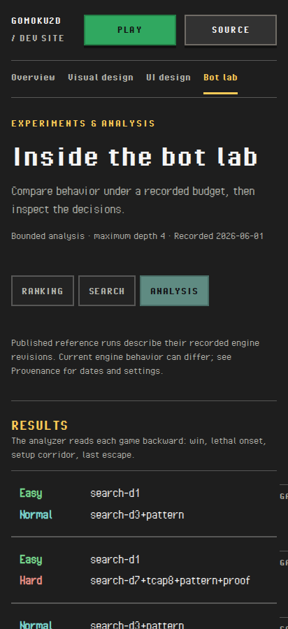

# 0.6.3 overall review — October 26, 2026

Reviewed source: `d5a602d`, locally on `main`, against `v0.6.2`. This pass covers
the full dev-site direction and implementation, current visual/UI references,
Bot lab, history/case navigation, public/private initialization boundaries,
capture/export tooling and the recent branding/navigation refinements.
Product and tool source are unchanged by this review.

[Open the prepared browser report](http://starship:8787/reports/847af48528c8e6eb3ac7bf37c817ee97049b9fbad75ce0de2d46eeec532ffbd7/)
for the findings, validation and the phone-layout capture.

The direction is coherent. A focused corrective pass should precede wrap-up.
Current screens is the default; UI history
and eight design cases remain easy to reach. Home and README navigation now use
the compact Dev site entry. Original/retrospective/mockup provenance remains
distinct, and the reviewed local build publishes only allowlisted material.

## Findings

| ID | Priority | Finding and required follow-up |
|---|---|---|
| R1 | P2 · product | **Bot lab Analysis overflows on phones.** Its summary grid remains `360px 86px 86px 86px 86px`; the page is 780px wide in a 412px viewport in all three engines, even with rows closed. The desktop selector at `ReportRoute.module.css:151` wins over the mobile CSS. A browser-only one-column probe removes the outer overflow. Fix responsive summary sizing and cover closed/open Analysis plus enlarged text. Preserve local proof-board scrolling. |
| R2 | P2 · accessibility | **Capture regions need distinct names.** `ReviewComparison.tsx:116` names regions only from repeated media captions. Eight cases produce `landmark-unique` reports; Mobile records repeats the same Before/After names three times. Add comparison context or unique heading/caption associations and verify full/native modes. The 24 reports are one best-practice issue repeated across eight cases and three view conditions, not 24 distinct WCAG failures. |
| R3 | P2 · validation | **The pending-write cloud check has a stale selector.** `cloudtests/developer.spec.ts:105` still clicks Developer after Home was renamed Dev site. D02 Chromium times out before testing the intended transition; cleanup then masks that failure with a closed-context error. Correct the selector/cleanup and rerun D02 in all engines. D01's persisted-session isolation and private-history return pass in all three engines. |
| R4 | P2 · tooling | **Single-case export lacks physical output containment.** `scripts/export_review.mjs:13` accepts a symlinked parent under the dedicated export directory. An owned probe wrote its new export into an owned temporary directory outside that root. Nothing existing was overwritten, and the probe was removed. Apply the full-site exporter's real-path/ignored-output protections and keep exclusive creation. |
| R5 | P3 · tooling | **The older visual checker races lazy image loading.** `scripts/check_developer_visuals.mjs:43` decodes every capture without requesting unloaded images. It fails in Firefox before persisting its final receipt. A focused probe fails directly and passes after requesting the images; image requests themselves succeed. Correct readiness and retain partial results when a later check fails. |

The screenshot is a current local-candidate capture at 412×900 CSS pixels,
DPR 1, Chromium, 100% text. It is not a measured handset. The source, hash and
exact test qualifications are in the [validation receipt](v0_6_3_overall_review/validation.json).

## Verification

- App/scripts/tools type checks and the production build/publishers pass.
- All 556 unit tests and 34 historical-capture tool tests pass.
- The full ordinary three-engine lane passes 291 journeys, with six intentional
  Firefox/WebKit WebGL pixel-qualification skips. Forced Canvas runs in all engines.
- Three emulator D01 journeys pass. D02 is a confirmed validation failure at the
  old selector, rather than evidence of private-write loss.
- A fresh 60-view Chromium UI audit covers desktop, portrait and 320px/200% text,
  including all ten reference/case records, history and all Lab/asset views.
  It finds the two Analysis overflow conditions and the repeated landmark issue;
  seven contrast checks remain inconclusive. No page errors or external requests
  occurred. Loaded comparison pairs retain matched scale without upsampling;
  closed/unloaded layout-check images are excluded from that measurement.
- All 585 served build files (22,832,410 bytes) match SHA-256. The separate
  source/media check passes 168 bindings, including unchanged recorded Lab JSON.
- Checked Node/tool versions are recorded; Vite, Playwright, TypeScript and axe
  match the current lock. This pass did not reinstall dependencies.

The D02 locator failure was extracted from its raw trace before the sequential
D01 run replaced the shared cloud artifact directory. The observation is
retained in the local evidence directory; the replaced trace is not presented
as a retained artifact. Subsequent cloud reruns should use distinct output paths.

## Next checkpoint

Fix R1–R5 as a bounded pass. Rerun the affected responsive/accessibility checks,
the complete cases' region-name checks, D02 in all engines, output-guard probes
and the maintained visual helper. Then take a short visual pass on the narrow
Analysis layout and current dev-site navigation before release preparation.

The loopback preview and shared report server remain in place. Owned emulator
processes and headless containers stopped; the symlink/temp-output probe was
removed. No user tabs or worktrees were opened/removed. No push, version bump,
tag, production deployment or real-account writes occurred. Hosted CI,
publication, measured-phone and human assistive-technology acceptance remain
separate from this local review.
