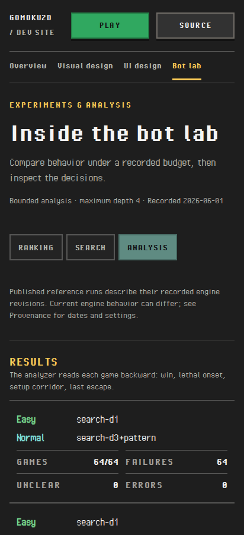

# 0.6.3 overall-review fixes

Owner: Bryan. Authorized with luna-goal-loop on October 26, 2026, from
`5a60e3d`. This pass resolves R1–R5 from the
[overall review](v0_6_3_overall_review.md). The primary owns layout, copy/design,
integration and acceptance; Luna Max owns bounded accessibility/validation/export
implementation. Commit locally in cohesive stages. No push, tag/version change,
production deployment or real-account writes.

## Intended behavior

- **R1:** Analysis keeps the bot pair together and wraps metrics into readable
  rows as viewport/text space narrows. Nested game summaries also fit. Fixed
  proof boards retain their own scroll area, without widening the page.
- **R2:** Capture region names include comparison context while keeping visual
  captions, image bytes, record IDs and inspection controls intact.
- **R3:** D02 reaches the Dev site link and validates the held private write.
  Cleanup releases the route and preserves the original failure if a test fails.
- **R4:** Single-case and full-site exports stay in their dedicated ignored
  physical output roots. Reject symlinked parents and existing targets before
  writing; preserve normal CLI usage and the selected export contents.
- **R5:** The visual helper requests/waits for audit images, retains partial
  evidence with explicit failure status, and can use a fresh owned output path.

Historical data/media, recorded Lab JSON, matched/native inspection, latest-first
history, Current screens as the UI entry and compact Home/README navigation
remain intact. The public dev-site tree still initializes no private state or
game engine. Previously inconclusive contrast and human/device acceptance keep
their recorded scope.

## Exit gate

Review the actual diffs and failure paths. Run proportionate guard/data/type/unit
checks and a production build, three-engine Analysis and complete-case
accessibility/inspection checks, D01/D02 on owned emulators with distinct output
directories, safe export probes and both standalone/full-preview checks. Run the
maintained visual helper through completion; retain inconclusive results.
Resolve integration findings, inspect the phone layout, record qualified source
and validation, commit locally, deliver a portable preview through the shared
report host and verify its real prefix/Snap access when available. Clean only
owned temporary services, browsers and probes.

## Execution

Completed locally on October 26–27, 2026. Tested implementation source is
`c1c3af6`; the closing documentation commit does not change those inputs.
The [validation receipt](v0_6_3_review_fixes/validation.json) records source and
artifact hashes, commands, qualifications and delivery results.

| Finding | Resolution and verification |
|---|---|
| R1 | Analysis pair metrics wrap into readable rows, and nested game summaries adapt to available space. Three engines pass closed/open, direct-match entry and local proof-board scrolling at six viewport/text configurations, including 320px/200% text. A per-word assertion guards against labels wrapping into individual letters. |
| R2 | Region names include their comparison title. All eight design cases have unique names; full, bounded and native inspection retain contextual names and controls. The final 60-view audit has no landmark reports. |
| R3 | D02 clicks **Dev site**, releases its held route and preserves an earlier failure during cleanup. Fresh offset-4000 emulator runs pass D01 and D02 in all three engines, with distinct retained artifacts. |
| R4 | Both exporters use the same physical-path/ignored-root guard and create output exclusively. Guard tests and actual CLI probes reject symlinked parents, existing targets and source/dist escapes. Relative and absolute single-case exports and the full-site export succeed; repeated full-site export leaves the existing receipt unchanged. |
| R5 | The visual helper requests hidden lazy captures without opening disclosures or moving the page, waits for their pixels, and persists partial results with explicit status. Its fresh final run completes all 66 views in three engines. Failure/load/persistence tests also pass. |

The primary implemented and reviewed R1, settled the accessible-name format,
reviewed Luna's R2–R5 changes and owned integration, visual inspection, browser
and emulator validation, export checks and preview delivery. Luna implemented
the bounded accessibility, cloud-test and tooling changes. During integration,
the new narrow-layout regression caught a second expanded-summary overflow;
visual inspection then caught squeezed labels that overflow checks alone missed.
Both were corrected before the final run. Initial failure artifacts remain
separate from passing reruns.

This is a local-candidate Chromium capture at 412×900 CSS pixels, DPR 1 and
100% text. The original review's before image and receipt remain unchanged.
The primary inspected the resulting desktop and narrow layouts; this is not a
measured handset or human assistive-technology acceptance result.

## Completed gate

- App/scripts/tools type checks, production build and publishers pass.
- All 556 unit tests and 44 Node tool tests pass (34 existing capture checks
  and ten new export/image-audit checks, including subtests).
- All 105 affected browser tests pass across Chromium, Firefox and WebKit.
  These cover developer/history/case navigation, responsive Analysis and the
  product smoke journeys. The earlier full 291-journey review remains a separate
  baseline; it was not repeated or relabelled as a new full-suite run.
- D01/D02 pass six emulator journeys. This integration run precedes the final
  metric-only CSS refinement; its cloud-test source is identical to `c1c3af6`.
  The final public/private static boundary also passes in the committed-source
  browser and portable-preview checks.
- The fresh 60-view Chromium audit has zero violations, outer overflows, page
  errors or external requests. All 135 measured loaded image pairs retain
  matched scale without upsampling. Seven contrast checks remain inconclusive.
- The maintained 66-view three-engine helper completes with zero violations and
  nine inconclusive contrast checks. These overlapping audits are different
  matrices, not additional distinct accessibility issues.
- Actual standalone exports pass both CLI path forms in all three engines,
  including unique region names, native/reload/Back and 320px/200% text. The
  hosted full preview passes 34 routes per engine, Current screens entry,
  navigation and history focus/scroll/disclosure return. Private storage stays
  empty; no private controllers, game engine or external service is requested.
- All 585 served application-build files match locally (22,833,886 bytes).
  Snap independently fetches all 489 portable-preview files with matching
  SHA-256 hashes (19,623,330 bytes). Historical/media/catalog and recorded Lab
  inputs are unchanged by the fix commits.

## Preview and remaining acceptance

[Open the corrected dev-site preview](http://starship:8787/reports/e3bfaed9db85aa1f1951ebc95a00d29952aa422498d38c4d17452e66a7d6c887/).
It is an immutable static export from clean source `c1c3af6`, served through the
shared report host; it is not a production deployment. It opens on Current
screens. Use **Bot lab → Analysis** to inspect the responsive fix.

Owned test previews on 47436/47437 and emulator services are stopped. The
existing manual preview on 46862 and shared report host on 8787 remain running.
No user tabs or worktrees were opened/removed. Commits remain local; no push,
version bump, tag, release, production change or real-account write occurred.

Human phone and assistive-technology acceptance, inconclusive contrast review,
and release/hosted-CI preparation remain separate. None of R1–R5 remains open.
