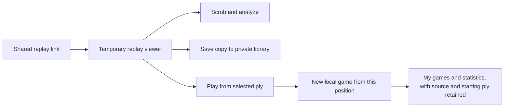

# Public Profiles and Shareable Replays Design Draft

Implementation status: M0–M5 now exist in the local candidate. This document
retains the design rationale and original proposals; resolved portable/storage
contracts live in [portable replay](../reference/app/portable_replay.md) and
[sharing data](../reference/backend/sharing_data.md). The
[execution record](v0_6_execution.md) owns final defaults and acceptance evidence.

October 22 manual-review decision: completing Play From Here creates a regular
game in My games and ordinary statistics, with no Practice badge or separate
section. Source/starting-ply metadata is retained internally. This supersedes
the practice-category policy in the earlier execution and acceptance receipts.

Owner: Bryan. Started October 21, 2026. The v0.6 direction is public profiles
and shareable replays; multiplayer remains deferred. Implementation is active
under the authorized Luna goal loop. The [execution record](v0_6_execution.md)
distinguishes accepted defaults and implemented contracts from remaining
proposals. Nothing here establishes a deployment or runtime acceptance pass.

## Product Goal

A person can send a game or an interesting moment to someone else, who can
inspect it, analyze it, and try another line immediately. A player can also
share a public page containing games they explicitly chose to publish.

The first experience works for one visitor without an account or an opponent.
Preserve the existing visual language, board, replay transport, and local-play
entry. Reuse static hosting, Firebase Auth, and Firestore. Backend usage belongs
to deliberate profile, library, and publication actions rather than live moves
or replay scrubbing.

## Feature Boundaries

| Area | Proposed v0.6 behavior |
|---|---|
| Portable replay | A complete game in a versioned URL fragment, optionally opening at a selected ply |
| Shared viewer | Open, scrub, analyze, and continue without sign-in or automatic import |
| Private library | Save explicit copies separately from games the viewer played |
| Public identity | Opt-in public name and a stable profile URL using the existing account UID |
| Published games | A bounded list on that player's public profile, populated by explicit Publish actions |

The goal-loop instruction accepts own-game publication and private-library
sync for signed-in users; guests keep their library locally. Imported replay
curation remains deferred. Other recommended product defaults are recorded
in the execution record; implementation measurements settle technical bounds.

Global replay discovery, unique handles, uploaded avatars, social interactions,
rankings, and multiplayer are outside this proposed slice. A built-in avatar
can be added without introducing image uploads or another storage service.

## Identity and Profile Ownership

Use the existing Firebase Auth UID as the account key. A fixed public entry
such as `/player/?id=<uid>` fits the current static hosting; the existing
`/profile` remains the owner's private record.
UIDs are stable references, not evidence that an account played a particular
client-supplied game. Display names need not be unique.

Keep separate records for public and private data. Firestore read rules apply
to whole documents, so a public reader must never receive the private profile
and rely on the UI to hide fields.

| Record | Proposed contents | Readers and writers |
|---|---|---|
| Firebase Auth | Account and provider identity | Existing authentication flow |
| `profiles/{uid}` | Existing private settings, history, sync/reset state, and publication controls | Owner only |
| Private replay library | Capped saved replay copies and save metadata | Owner only; guests use local storage |
| `public_profiles/{uid}` | Public name, optional explicitly shared aggregate statistics, version and timestamps | Anyone reads an enabled profile; owner writes |
| Public replay catalog | Selected portable payloads and small listing summaries | Public browsing scoped to one enabled profile; owner publishes/unpublishes |

The public name is explicitly confirmed when enabling the profile. It can be
prefilled from the chosen in-game name, but Google provider names/photos are
not automatically published. The public record is authoritative for the name
on the current public page. Existing private in-game naming remains usable
for guests and people without public profiles. Whether editing a public name
should also update the future in-game name is a remaining UX choice; no silent
two-way mirroring is implied.

A public profile exposes selected publications without private history, settings
or provider details. The [0.6.1 functional contract](v0_6_1_public_profile.md)
supersedes the initial no-public-stats boundary: owners may explicitly share a
dated aggregate snapshot, independently of profile visibility. This is off by
default; refresh and removal are explicit. No public rating, avatar or bio is
included in this pass.

## Portable Replay Record

Encode the complete ordered game from the empty board, including the prefix
before the shared moment. Initial support follows current finished records:
15x15 Freestyle/Renju games ending in a board win or draw. Resignation, clock
results, arbitrary starting boards, and new opening protocols require later
format extensions rather than fabricated terminal states.

| Part | Contents |
|---|---|
| Format | Explicit version with a backward-reading policy |
| Game facts | Rules variant and ordered move cells; v1 fixes the board/opening contract |
| Each human | Bounded name snapshot and optional public profile UID |
| Each bot | Bounded label and versioned preset/custom configuration |
| Continuation origin | When applicable, inherited-prefix length and a bounded source fingerprint |
| Viewing position | Optional initial ply, separate from game identity |

Profile references are optional. A guest or private player can share using a
label alone. Export preview shows the labels and profile references that will
travel in the link, including an option to use generic player labels and omit
profile links. Keep private profile IDs, provider information, and unrelated
settings out of the export.

For a profile-linked human, retain a name snapshot alongside the UID. It is the
label chosen for that export, not a claim about their current profile name.
The replay renders the snapshot without fetching the profile. Clicking the
profile link loads current public identity. Missing/private/deleted profiles
do not prevent replay viewing.

Continuation origin must survive export and publication as metadata, without a
separate game category or badge. Include no private source
record ID or recursively embedded ancestry. The complete move sequence still
stands alone if the source is unavailable. These fields describe client-supplied
provenance, not independently verified participation.

Rebuild the board and result through Rust/Wasm and recompute bounded analysis
in the recipient's browser. The link does not carry trusted analysis results
or a server-verification flag. Preserve the analyzer's possible/confirmed
distinction when presenting recomputed findings.

A 15x15 cell fits in one byte. The move stream alone is at most 225 bytes, or
300 base64url characters. Metadata and the final encoding add overhead. Bound
encoded input, decoded size, names, move count, and metadata before accepting
a link. Verify legal moves, duplicate cells, terminal progression, and result
consistency; do not rely on object-shape checks alone.

The codec, canonical fingerprint, exact byte layout, and limits need a small
format specification before implementation. Viewing ply must not change the
fingerprint used to deduplicate a saved replay. Transport adapters should let
the same decoded replay feed the viewer from a URL, a private library, or a
public catalog. Define which participant/provenance fields belong to canonical
identity before choosing the hash. Repeated saves must not silently replace a
saved attribution snapshot with different incoming metadata. A fingerprint is
a deduplication tool, not proof of ownership or authenticity.

Apply the same decoder and rules validation to public catalog payloads and
synced library copies. Catalog listing summaries are provisional until the
game is decoded; recompute the displayed result in the viewer. Render supplied
labels/titles as text, and construct profile links from validated UIDs using
the app's own route rather than accepting arbitrary URLs or markup.

## Viewing Saving and Continuing

| Action | Effect |
|---|---|
| Open link | Decode/validate and show a shared replay; no permanent library import |
| Scrub or analyze | Change the view or local analysis cache; no account/history write |
| Save replay | Create or find an explicit saved-library copy; show Saved without duplicates |
| Play From Here | Start a local game from the chosen legal frame; leave the source replay intact |
| Finish continuation | Add a regular played game and normal statistics, retaining source and branch ply internally |
| Copy replay link | Build the portable link locally; no public catalog write |
| Publish | Deliberately add a catalog entry under the owner's enabled public profile |

The private profile UI distinguishes My games and Saved replays. Imported
games do not enter played-game summaries or win/loss statistics. Completing a
continuation counts as playing a game, including ordinary win/loss statistics.
Its source and inherited prefix remain metadata for replay/export behavior;
they do not create a separate list or badge. These casual client-controlled
statistics do not require a separate category to prevent inflated totals.

Saving as a guest is local. Under the sync proposal, a signed-in user's library
uses the existing account, with its own cap, merge/reset rules, pending state,
and retry path. Loading a shared link must not wait for private cloud history.
Prefer a separately loaded, capped library document over silently growing the
existing private profile/history snapshot. The precise storage family and cap
are part of the size/conflict design before implementation.

Scope account-library caches and pending operations to the originating UID.
Signing out or changing accounts must not reveal or upload another account's
copies. Define an explicit guest-library import action rather than silently
promoting guest saves when someone signs in or opens a shared link. Under the
sync proposal, removing a saved copy must survive a stale/offline device's next
merge; deletion markers or an equivalent versioned operation model are needed.

The shared viewer and public page must not use the current private-history
loader as a dependency. Review the globally mounted CloudSessionController
when introducing these routes: opening a portable replay should not itself
trigger private-history loading, promotion, or syncing. Auth-dependent owner
actions can initialize their required account state when used. Verify this
boundary for already signed-in visitors as well as fresh guests.

If a local match is already active, Play From Here must offer a clear choice
before replacing that session. Starting the continuation does not itself save
the original shared replay to the library.

Retain the existing continuation contract initially: a legal, nonterminal
frame at or beyond the current minimum ply/undo floor, with the visitor taking
the side to move against the currently selected local bot. Show that setup
before starting. Stored bot identity is descriptive; it does not promise that
an old engine/configuration can be reproduced by the current app. A different
side-selection or bot-selection flow would be an additional UX decision.

## Sharing and Publishing

Share opens a compact preview with Copy link, the chosen player labels/profile
references, and a choice of final frame or current ply. Anyone may create a
portable link; sign-in and a public profile are not required.

Publish is a separate action requiring sign-in and an enabled public profile.
Preview the public name, replay title/labels, game summary, and opening ply
before publishing. A network or rules failure leaves the private game intact
and reports that publication did not complete. Pending publication must not
appear as a successful public listing.

The public page lists only explicit publications. Proposed default: initially
publish only games from the owner's played history, leaving imported curation
for a later decision. This is a product restriction for honest clients, not
server proof of participation. The catalog authenticates who published a
record; game/player claims remain client-supplied.

Each catalog entry retains the portable payload as a snapshot. Existing links
do not change when the public title, profile name, or listing order changes.
Opening an entry uses that payload in the same shared viewer. Copy link always
produces the portable link rather than requiring a hosted replay lookup.

## UI Surfaces and States

| Surface | Changes and essential states |
|---|---|
| Private Profile | My games, Saved replays, public-profile management, and a public-page preview/link |
| Replay | Compact shared/saved context plus Share, Save, Play From Here, and eligible Publish actions |
| Public Player page | Public identity and a bounded published-game list; loading, empty, unavailable, and retry states |
| Profile management | Opt-in preview, public-name editing, publication list, Unpublish, and Disable public profile |

The board and transport retain the current visual language. Add short action
groups and contextual panels rather than a social dashboard. Keep connection
and storage terminology in recovery details only when it helps the player act.

Malformed or unsupported links show an actionable unavailable state without
creating a library entry. A shared replay must never relabel its human players
as the viewing user's private name. Public-profile lookup failure leaves the
portable game usable. Guest Save explains local storage; signed-in Save makes
pending cloud persistence distinguishable from a confirmed sync.

Suggested route roles are `/profile` for private records, a fixed `/player/`
entry with the UID in a query parameter, and `/replay/shared/` with the payload
in the fragment. Publish fixed entry pages so direct links and refreshes work
with ordinary successful responses on GitHub Pages. A cleaner `/player/:uid`
path would need a deliberate fallback strategy; do not assume a Vite dev-server
route proves static-host behavior. Exact labels/layouts follow the journey
design.

## Visibility and Deletion

| Action | Proposed effect |
|---|---|
| Remove saved replay | Remove that library copy, preserving the source and played history |
| Unpublish replay | Remove the catalog entry, preserving private records |
| Disable public profile | Make the public page unavailable and remove its publications; explicit publishing is required after re-enabling |
| Reset private records | Clear the selected private scope; do not silently change public publication settings |
| Delete cloud data | Include private cloud profile/library and public profile/publications in the reviewed deletion flow; preserve local data per the existing product contract |

These are proposed lifecycle defaults. Copied portable links cannot be revoked
by catalog removal or profile deletion. State that consequence in Publish and
Unpublish/Disable flows. Existing generic Reset/Delete labels need review so
the expanded scope is visible before any destructive action.
Disabling must block future public server reads before cleanup is reported as
complete; already downloaded or cached public data cannot be recalled.

Bound the catalog so removal can be implemented and verified without an
unbounded cleanup service. Deleting a profile document alone is insufficient
because nested or separate publication records need their own removal/access
handling. Failed cleanup must remain visible and retryable. Re-enabling must
not resurrect old entries automatically, and stale tabs/pending writes must
not reverse a completed unpublish/disable/delete action. Specify profile and
entry generations or equivalent invalidation before implementing these
operations. Prove the behavior across deletion/recreation of control records,
not only while a disabled profile still exists. If a minimal deletion marker
must remain to reject stale writes, make that retention explicit in the cloud
deletion contract rather than claiming every cloud record was erased.

## Storage Access and Cost Proposal

Use owner-scoped private documents and separate public documents with strict
field/size bounds. Candidate catalog storage is under each public profile;
the global replay namespace remains a possible alternative, not a deployed
schema. Public query permissions must match the selected per-profile query.
Allow public profile lookup by known UID while keeping broad profile-directory
queries closed. Owner checks, allowed fields, payload limits, and catalog
query limits belong in rules as well as the browser. Profile-linked attribution
remains distinct from authenticated catalog ownership.

Initial sizing candidates are eight public entries per page and 32 published
entries per account, with a bounded encoded payload per entry. These are
proposals, not measured capacity. Enforce catalog limits through the data
layout and rules, not a client-only counter. Fixed bounded slots or a capped
manifest are options to compare before finalizing storage; a standalone
counter is not sufficient if arbitrary batched creates can undercount entries.

| Journey | Intended backend work |
|---|---|
| Open/copy portable replay, scrub, analyze, or branch | No replay/profile database operation; existing static app delivery still applies |
| Open public profile | One public identity read plus one bounded catalog page |
| Page catalog | Fetch the next page only on request, using cursors where applicable |
| Publish/unpublish | Bounded explicit catalog writes/deletes and any required control updates |
| Save private copy | Local persistence and optional bounded account sync |

With one document per public entry, eight entries plus the profile means nine
base document reads for the initial page, before rules-dependent reads and
retries; an empty catalog query still has a minimum read charge. A capped
page/manifest can reduce read count at the cost of larger responses and
page-update coordination. Compare both using actual payload sizes rather than
assuming either is free at arbitrary traffic.

Avoid always-on public listeners, profile resolution on replay open, per-view
counters, image uploads, and server analysis. Exempt unused payload fields
from indexing. Model document operations, egress, storage, and existing private
sync together. Firebase free allowances remain usage allowances on a billing-
enabled project, not an unlimited zero-cost promise.

Per-account publication caps bound retained data, not aggregate traffic or
reads from repeated public visits. Establish a measured expected-use budget
and a documented way to disable public reads/publication if needed; the
portable replay viewer should continue to work independently. Broader abuse
controls remain a separate infrastructure decision if real usage warrants them.

## Delivery and Acceptance

The [implementation roadmap](v0_6_implementation_plan.md) expands this sequence
into milestones, code touchpoints, decision dependencies, and exit evidence.
It does not turn the remaining proposed defaults into accepted behavior.

1. Specify the portable record and build encode/decode/validation round trips,
   including maximum and malformed inputs and old-version behavior.
2. Separate replay loading/presentation from private played history; prove a
   fresh guest can open, analyze, and branch from a link.
3. Add the distinct saved library and agreed persistence/statistics behavior.
4. Add public-profile opt-in, explicit publication, and the bounded catalog.
5. Exercise lifecycle, stale-operation, accessibility, and cost boundaries.

Acceptance covers a single-person demo: finish/open a game, share a chosen
moment, open it in a fresh guest session, analyze/continue, save a private copy,
and browse a deliberately published game via the public profile. Include
desktop/mobile, keyboard access, storage/network denial, private-profile
isolation, missing public identities, repeated-save deduplication, stale
account/tab writes, guest/account library isolation, offline deletion merges,
practice export round trips, unpublishing, and partial-deletion recovery.
Measure the actual read/write/egress shape of the public page and library sync
before claiming a free-tier traffic envelope.

## Review Record

The October 21 design review checked these current implementation constraints:

| Evidence | Design implication |
|---|---|
| [Private replay loader](../../gomoku-web/src/replay/use_replay_match.ts) | Shared loading needs a separate input path from played history |
| [Replay player labels](../../gomoku-web/src/replay/local_replay.ts) and [profile statistics](../../gomoku-web/src/routes/ProfileRoute.tsx) | Preserve exported names and keep imports out of played-game statistics |
| [Saved match model](../../gomoku-web/src/match/saved_match.ts) and [continuation setup](../../gomoku-web/src/game/local_match_store.ts) | Export a dedicated portable record and preserve inherited-prefix provenance |
| [App shell](../../gomoku-web/src/app/App.tsx) and [cloud session controller](../../gomoku-web/src/cloud/CloudSessionController.tsx) | Route isolation must also prevent eager private cloud work for signed-in visitors |
| [Static route publisher](../../gomoku-web/scripts/publish_spa_routes.mjs) | New fixed entry routes need production-host direct-load checks |
| [Current Firestore rules](../../firestore.rules) | Existing profiles remain owner-only; public publication needs separate schemas/rules |

Firebase documentation was rechecked for whole-document access, query/rules
read charges, and non-cascading document deletion. Documentation whitespace,
relative links/anchors, and Markdown structure are checked before committing.
This is design validation; no v0.6 runtime behavior or traffic capacity has
been demonstrated. Open choices below remain explicit implementation gates.

## Remaining Decisions

- Own played games only versus imported replay curation on public profiles.
- Cross-device Saved replays in v0.6 versus a local library first.
- Independent public name versus an explicit coupled rename of the in-game name.
- Confirmation of disable/reset/delete scopes; continuation statistics now follow regular games.
- Final caps, catalog layout, private-library import/merge/reset model, and stable codec.
- Lifecycle invalidation, any retained deletion markers, and the public-read disable procedure.

## References

- [Roadmap](../reference/product/roadmap.md)
- [Current app design](../reference/app/app_design.md)
- [Current backend](../reference/backend/backend.md)
- [Current persisted model](../reference/backend/data_model.md)
- [Cost planning](../reference/ops/backend_cost.md)
- [Deferred multiplayer research](../reference/backend/p2p_multiplayer.md)
- [Firestore document access](https://firebase.google.com/docs/firestore/security/rules-fields)
- [Firestore billing](https://firebase.google.com/docs/firestore/pricing)
- [Firestore atomic operations](https://firebase.google.com/docs/firestore/manage-data/transactions)
- [Firestore deletion and subcollections](https://firebase.google.com/docs/firestore/manage-data/delete-data)
- [URI fragments](https://www.rfc-editor.org/rfc/rfc3986#section-3.5)
